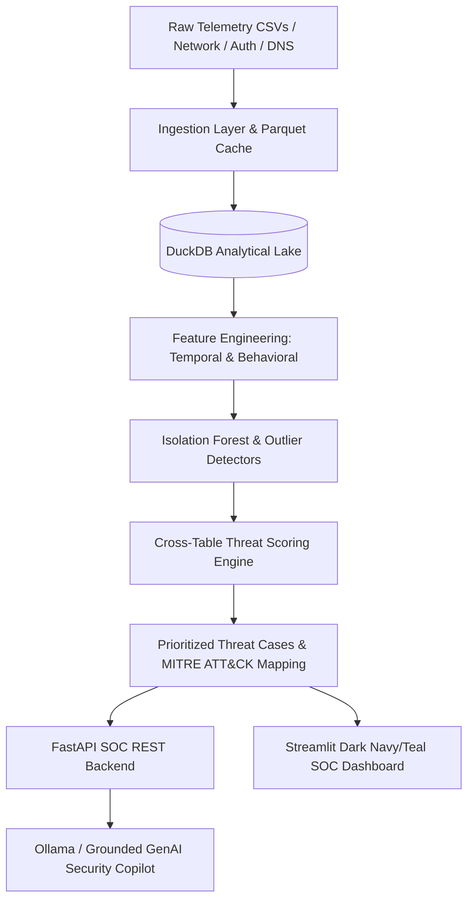

# CipherSentinel 🛡️

**CipherSentinel** is an enterprise-grade, locally runnable, AI-powered cybersecurity platform engineered for **insider threat detection**, **unusual data exfiltration prevention**, and **automated SOC decision support**.

---

## 🏛️ Architecture Overview

CipherSentinel combines multi-source behavioral telemetry correlation with unsupervised machine learning and grounded generative AI assistance:



### Key Pillars:
1. **Enhanced PBKDF2 Database Authentication**:
   - Secure user management persisted in [DuckDB](file:///d:/Team%20Synapse/backend/storage/storage.py) with salted PBKDF2-HMAC-SHA256 password hashing.
   - Immutable security audit trail recording all authentication attempts, token issuances, and user actions.
   - Role-based authorization (`admin`, `analyst`) with JWT bearer tokens.

2. **Multi-Table Cross-Source Threat Scoring**:
   - Aggregates telemetry across distinct sources (`network_flows`, `auth_logs`, `dns_queries`, `file_events`).
   - Computes dimensional sub-scores:
     - **Data Volume & Exfiltration Subscore** (logistic scaling on transfer sizes).
     - **Novelty & Rare Destination Subscore** (first-seen IP/domain rarity).
     - **Authentication Anomaly Subscore** (failed logins & brute-force indicators).
     - **DNS Tunneling Subscore** (high entropy queries & query volume spikes).
     - **Temporal Anomaly Subscore** (off-hours & weekend activity).
   - Applies contextual multipliers (Asset Tier 3 critical infrastructure x1.3, sanctioned operations x0.35).
   - Computes **Confidence Index** (0.0 to 1.0) and maps indicators to MITRE ATT&CK techniques (T1048, T1071, T1078, T1029).
   - Opens prioritized investigation cases for analyst triage.

3. **Streamlit SOC Command Dashboard**:
   - Cyber aesthetic with custom dark navy (`#070d1e`) and neon teal/cyan design.
   - **Interactive Timeline Replay Slider**: Scrub historical days/hours to inspect attack escalation trajectories over time.
   - **Dynamic Filter Controls**: Severity classification, minimum risk score threshold, and entity drill-down.
   - **Plotly Visualizations**: Threat severity donut charts, signal dimension radar diagrams, risk vs volume scatter plots, and temporal trajectory lines.
   - **Case Management Drawer**: One-click status updates (`OPEN`, `INVESTIGATING`, `MITIGATED`, `FALSE_POSITIVE`).
   - **Grounded GenAI Copilot**: Real-time analyst chatbot grounded in DuckDB telemetry findings.

---

## 🚀 Quick Start Guide

### 1. Prerequisites & Environment Setup
Clone the repository and activate Python virtual environment:
```powershell
# Windows
.\.venv\Scripts\activate

# Or install dependencies
pip install -r requirements.txt
```

### 2. Run All Automated Tests
Verify authentication, scoring aggregation, and the end-to-end telemetry pipeline:
```bash
make test
# Or directly via pytest:
pytest tests -v
```

### 3. Launch Backend API (FastAPI)
Start the REST API on port `8000`:
```bash
make run-backend
# Or:
uvicorn backend.api.main:app --host 0.0.0.0 --port 8000 --reload
```
- API Documentation (Swagger UI): `http://localhost:8000/docs`
- Default Admin Credentials: `admin` / `admin123`

### 4. Launch SOC Dashboard (Streamlit)
In a second terminal, launch the Streamlit user interface on port `8501`:
```bash
make run-frontend
# Or:
streamlit run frontend/dashboard/app.py
```
Open `http://localhost:8501` in your browser.

---

## 📡 API Route Reference

| Method | Endpoint | Description |
|--------|----------|-------------|
| `POST` | `/auth/token` | Authenticate user credentials and return JWT bearer token |
| `POST` | `/auth/register` | Register a new SOC analyst user (Admin restricted) |
| `GET`  | `/auth/me` | Fetch current authenticated user identity |
| `GET`  | `/auth/audit-logs` | Retrieve security audit events |
| `POST` | `/data/upload` | Upload CSV telemetry directly to DuckDB & Parquet |
| `POST` | `/data/ingest/{name}` | Ingest raw CSV from `data/raw` folder |
| `GET`  | `/data/table/{name}` | Query tabular data for visualization |
| `POST` | `/detect/detect` | Execute Isolation Forest anomaly detection |
| `GET`  | `/detect/tables` | List available DuckDB tables |
| `POST` | `/score/aggregate` | Run cross-table risk scoring and open cases |
| `GET`  | `/score/scores` | Query composite risk scores with filters |
| `GET`  | `/score/cases` | Query prioritized investigation cases |
| `POST` | `/score/case/{id}/status` | Update triage case status |
| `POST` | `/sim/generate` | Generate reproducible synthetic telemetry (CSV, Parquet, JSON) |
| `GET`  | `/sim/scenarios` | List 15 enterprise attack & benign lookalike scenarios |
| `GET`  | `/sim/manifest` | Retrieve cryptographic dataset manifest & hashes |
| `POST` | `/sim/ingest-synthetic` | Generate and directly ingest synthetic flows to DuckDB |
| `GET`  | `/graph/summary` | Aggregate node, edge, and density statistics |
| `GET`  | `/graph/elements` | Cytoscape.js serialized graph nodes and aggregated edges |
| `GET`  | `/graph/nodes` | Entity nodes with behavioral risk metrics |
| `GET`  | `/graph/edges` | Aggregated flow connections between entities |
| `GET`  | `/graph/timeline` | Time-binned flow counts for scrubber timeline |
| `GET`  | `/graph/entity/{id}` | Click-to-investigate deep profile with peer baseline comparison |
| `POST` | `/graph/replay` | Initialize deterministic temporal replay session |
| `GET`  | `/graph/replay/{id}` | Fetch frame snapshot for timeline replay session |
| `POST` | `/genai/generate` | Query Ollama LLM with deterministic fallback |

---

## 📂 Project Structure

```
CipherSentinel/
├── backend/
│   ├── api/
│   │   ├── main.py               # FastAPI application entrypoint (port 8000)
│   │   └── routers/
│   │       ├── auth.py           # Database-backed JWT auth & audit logs
│   │       ├── ingest.py         # CSV upload, quarantine & normalization
│   │       ├── detect.py         # Isolation Forest anomaly detection
│   │       ├── score.py          # Cross-table risk scoring & case triage
│   │       ├── sim.py            # Synthetic telemetry generator & scenario API
│   │       ├── graph.py          # Temporal graph, Cytoscape serializer & replay API
│   │       └── genai.py          # Grounded GenAI Ollama integration
│   ├── auth/
│   │   ├── auth.py               # JWT helper utilities & token validation
│   │   └── users_db.py           # DuckDB user store & PBKDF2 hasher
│   ├── graph/
│   │   └── graph_service.py      # Network graph aggregation & temporal timeline service
│   ├── sim/
│   │   └── synthetic_generator.py# 15-scenario synthetic telemetry generator & manifest
│   ├── ingestion/
│   │   ├── ingest.py             # Parquet storage & CSV reader
│   │   └── ingestion_service.py  # Ingestion validation, quarantine & UTC normalization
│   ├── scoring/
│   │   └── aggregator.py         # Cross-table multi-source threat fusion
│   ├── detectors/
│   │   └── detector.py           # Scikit-Learn IsolationForest detector
│   ├── features/
│   │   └── feature_engineering.py# Temporal and behavioral feature builder
│   └── storage/
│       ├── storage.py            # Thread-safe DuckDB SQL database interface
│       └── identity_vault.py     # Fernet-encrypted identity pseudonymization vault
├── frontend/
│   ├── dashboard/
│   │   └── app.py                # Full Streamlit SOC command center (port 8501)
│   └── graph-app/                # React + Cytoscape.js Graph Simulator (port 5173)
│       ├── src/
│       │   ├── components/
│       │   │   ├── CytoscapeGraph.tsx      # Dark SOC Cytoscape network canvas
│       │   │   ├── InvestigationDrawer.tsx # Click-to-investigate drawer
│       │   │   ├── ReplayController.tsx    # Play/pause/scrub timeline dock
│       │   │   ├── ScenarioLabView.tsx     # What-If scenario simulation lab
│       │   │   ├── ThreatCasesView.tsx     # Case triage and status lifecycle
│       │   │   ├── EvaluationLabView.tsx   # Multi-model evaluation benchmark
│       │   │   └── ThreatHuntingView.tsx   # Parameterized query builder
│       │   ├── App.tsx                     # Top navigation & view orchestrator
│       │   └── index.css                   # Dark SOC design system & CSS variables
│       └── package.json
├── tests/
│   ├── test_auth.py              # User authentication & PBKDF2 tests
│   ├── test_scoring.py           # Cross-table scoring aggregation tests
│   ├── test_integration_flow.py  # End-to-end API & pipeline integration test
│   ├── test_synthetic_generator.py # 15-scenario synthetic generator & manifest tests
│   └── test_graph_api.py         # Backend graph endpoints & Cytoscape serialization tests
├── run.py                        # Unified launcher for API, Streamlit & React Graph
├── Makefile                      # Standard developer workflow commands
├── pyproject.toml                # Project metadata & pytest configuration
├── requirements.txt              # Core Python dependencies
├── .env.example                  # Environment configuration template
└── LICENSES.md                   # MIT License
```

---

## 🛡️ License
Distributed under the MIT License. See [LICENSES.md](file:///d:/Team%20Synapse/LICENSES.md) for details.
